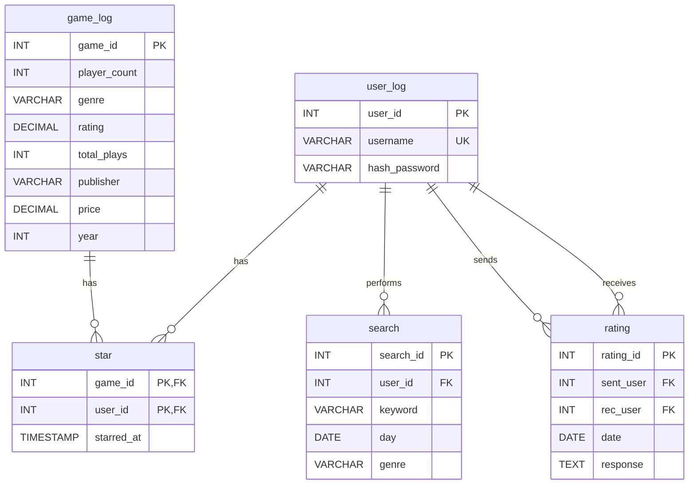

# Steam Game Filter (Better)
# Purpose
### The purpose of this project is to help steam users find games that might not pop up on their regular steam homepage. It helps filter, find, and secure great games with a user ran and reviewed rating system. Its simple, easy, and fun to use! Its a great software for new gamers and verterans alike.
#
# Use Cases
### My system uses well thought out filter and recommendations through remerebing users and keeping track of their searches, favorite games, rated games, cost, player count, and steam reviews. Users have drop boxes and boxes to type and check off what they want to see or not.
#
# Business Rules
### 1. Every account (User_id) only have one username and one Hash password.
### 2. Every Game must be made after 1970, ratings is only from 0.00 to 10.00, player count cannot be negative, every game gets one id, price cannot go below 0.00.
### 3. Every star needs a user_id, game_id and timestamp of when it was stared. 
### 4. Every table needs a search_id, user_id, date it was searched, can have multiple geners and keywords.
### 5. Every rating needs rating_id, sent_user, rec_user, and when it was sent. Does not need a responce though.
#
# Data Dictionary & Entity Relationship Diagram

## Entity Relationship Diagram

---

## Data Dictionary

### Table: `user_log`
Stores user profile credentials and account identifiers.

| Column Name | Data Type | Key / Constraints | Description |
| :--- | :--- | :--- | :--- |
| `user_id` | INT | Primary Key, Auto Increment | Unique auto-generated identifier for each user. |
| `username` | VARCHAR(100) | Unique, Not Null | Unique username for user login. |
| `hash_password` | VARCHAR(255) | Not Null | Encrypted/hashed user password. |

---

### Table: `game_log`
Stores game catalog metadata and statistics.

| Column Name | Data Type | Key / Constraints | Description |
| :--- | :--- | :--- | :--- |
| `game_id` | INT | Primary Key | Unique identifier for each game. |
| `player_count` | INT | Default: 0, Check (`>= 0`) | Total active or registered player count. |
| `genre` | VARCHAR(50) | Not Null | Primary classification genre of the game. |
| `rating` | DECIMAL(4, 2) | Check (`0.00` to `10.00`) | Average review score rating. |
| `total_plays` | INT | Default: 0, Check (`>= 0`) | Cumulative number of times played. |
| `publisher` | VARCHAR(100) | None | Name of the publisher or studio. |
| `price` | DECIMAL(10, 2) | Check (`>= 0.00`) | Retail price of the game. |
| `year` | INT | Check (`>= 1970`) | Release year of the game. |

---

### Table: `star`
Junction table tracking favorite/starred games per user.

| Column Name | Data Type | Key / Constraints | Description |
| :--- | :--- | :--- | :--- |
| `game_id` | INT | Primary Key, Foreign Key (`game_log.game_id`) | ID of the starred game (On Delete Cascade). |
| `user_id` | INT | Primary Key, Foreign Key (`user_log.user_id`) | ID of the user starring the game (On Delete Cascade). |
| `starred_at` | TIMESTAMP | Default: `CURRENT_TIMESTAMP` | Timestamp when the game was bookmarked. |

---

### Table: `search`
Logs user search activity and query filters.

| Column Name | Data Type | Key / Constraints | Description |
| :--- | :--- | :--- | :--- |
| `search_id` | INT | Primary Key, Identity | Unique identifier for the search log record. |
| `user_id` | INT | Foreign Key (`user_log.user_id`) | ID of the user conducting the search (On Delete Cascade). |
| `keyword` | VARCHAR(255) | None | Text search terms entered by the user. |
| `day` | DATE | Default: `CURRENT_DATE` | Date when the search query was submitted. |
| `genre` | VARCHAR(50) | None | Genre filter applied during the search. |

---

### Table: `rating`
Logs peer-to-peer ratings or responses between users.

| Column Name | Data Type | Key / Constraints | Description |
| :--- | :--- | :--- | :--- |
| `rating_id` | INT | Primary Key, Identity | Unique identifier for the rating entry. |
| `sent_user` | INT | Foreign Key (`user_log.user_id`), Check (`sent_user <> rec_user`) | ID of the user sending the feedback (On Delete Cascade). |
| `rec_user` | INT | Foreign Key (`user_log.user_id`) | ID of the user receiving the feedback (On Delete Cascade). |
| `date` | DATE | Default: `CURRENT_DATE` | Date when the rating was submitted. |
| `response` | TEXT | None | Optional text content or feedback response. |
